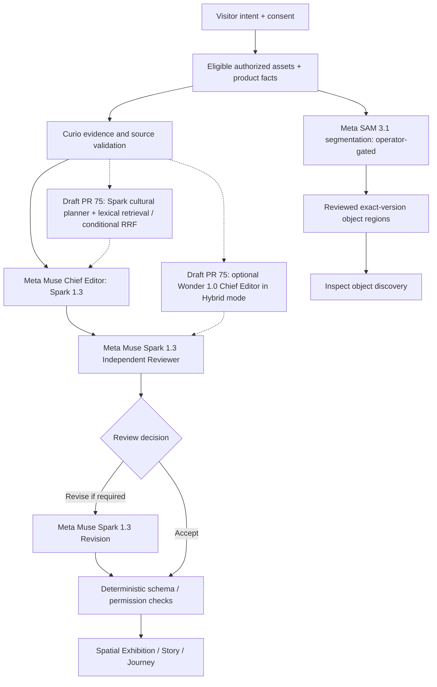

# Curio — Make Once Matter.

*Keep the impression. Clear the traces.*

**Curio** is an AI-powered, curiosity-led editorial discovery experience. Visitors choose interests; Curio uses approved advertising imagery, authorized brand/product information, and, when enabled and reviewed, cultural evidence to create an interactive editorial journey. The project explores **Audience-Led Discovery** and **Mixed-Funnel Marketing**: bringing storytelling, product discovery, and purchase consideration into one audience-led experience.

**The problem:** Digital platforms encourage fast, continuous consumption rather than curiosity and intentional understanding. For fashion, interior and premium brands, advertising often struggles to connect awareness with commercial consideration without relying on discounts. **The proposed solution:** a slower, interactive editorial space in which people choose what they want to discover. No improvement in recall, trust, conversion or revenue has been measured.

## Live demo and status

- Public site: **https://curio.shuang-han807.workers.dev/** (URL configured in `wrangler.jsonc`; the current live deployment/version has **not** been independently verified for this documentation).
- Supported code paths: Discover prompt and preferences → editorial generation or disclosed deterministic fallback → spatial Exhibition / Story → Inspect → Journey / Clear. Real approved SAM regions render in Inspect only when exact-version, reviewed records are available.
- Tested browser evidence includes automated **Chromium** scenarios. Do not infer Safari, Firefox, or physical-device acceptance from Chromium tests.
- AI consent, operator access, eligible content, and server flags can restrict live features. Repository defaults have AI inference **off**.
- Three-minute submission video: **not yet supplied**; add a verified link when recorded.

The repository's `main` includes [Exhibition Option A, PR #76](https://github.com/pipekoder/curio/pull/76). As audited on **2 November 2026**, [Cultural Intelligence V3 / model-routing PR #75](https://github.com/pipekoder/curio/pull/75) remains **draft and unmerged**; do not treat its APIs or Hybrid mode as currently deployed. The README will need an evidence-backed release update after merging/deployment.

## What I Built During the Hackathon

**Audit window:** 26 October–4 November 2026 (event timezone must be confirmed against official rules before asserting exact eligibility cutoffs). The earliest visible repository foundation commits are dated **26 October 2026 UTC**. The available history does **not** establish that no earlier off-repository ideas, designs, prototypes or infrastructure existed; those cannot automatically be claimed as created during the event.

| Feature / component | Pre-existing or new (repository evidence) | Hackathon contribution and scope | Evidence |
| --- | --- | --- | --- |
| Discover / homepage | Initial app scaffold during event | Initial prompt entry; later spatial Discover visual treatments | [PR #1](https://github.com/pipekoder/curio/pull/1), [PR #72](https://github.com/pipekoder/curio/pull/72), `src/spatial/SpatialApp.tsx` |
| Muse editorial workflow | Developed during event on foundation | Server-side Meta Muse editorial construction, structured validation, existing deterministic fallback | [PR #15](https://github.com/pipekoder/curio/pull/15), [PR #68](https://github.com/pipekoder/curio/pull/68), `worker/editorial.ts` |
| Lite / Hybrid routing | **PR #75 only; not merged** | Optional Spark Chief Editor or Wonder Chief Editor; no authorized live Wonder validation | [PR #75](https://github.com/pipekoder/curio/pull/75), `shared/editorial-model-contract.ts` (PR branch) |
| Cultural Intelligence | **PR #75 only; not merged** | Bounded planner, lexical retrieval, conditional TypeScript RRF, human-reviewed evidence packs and relationships | [PR #75](https://github.com/pipekoder/curio/pull/75), `worker/cultural-*.ts` (PR branch) |
| Independent Reviewer / Revision | Developed during event | Separate Muse review, bounded targeted revision, validation | [PR #68](https://github.com/pipekoder/curio/pull/68), `worker/editorial-reviewer.ts` |
| SAM 3.1 / Inspect | Developed and extended during event | Server-side segmentation adapter; exact-version reviewed region workflow; opt-in Inspect UI | [PR #69](https://github.com/pipekoder/curio/pull/69), [PR #73](https://github.com/pipekoder/curio/pull/73), `worker/sam-client.ts`, `src/spatial/ObjectDiscovery.tsx` (confirm exact path) |
| Spatial Exhibition | Developed during event | 3D exhibition, later rigid lateral camera bias, fixed-right Story card and visible image queue | [PR #72](https://github.com/pipekoder/curio/pull/72), [PR #76](https://github.com/pipekoder/curio/pull/76), `src/spatial/CameraRig.ts` |
| Journey / Clear | Developed during event | Existing editorial journey and session-clearing experience, retained through visual PR #76 | `src/spatial/SpatialApp.tsx`, [PR #76](https://github.com/pipekoder/curio/pull/76) |

See [Hackathon contributions and chronology](docs/hackathon-contributions.md) for exact evidence and non-claims. A pre-event, external project/design baseline has not been supplied; disclose it if relevant.

## Meta AI architecture



**Meta models:** `muse-spark-1.3` handles existing editorial model stages; `sam-3.1` is the separate visual segmentation model. **Proposed Hybrid** in unmerged PR #75 routes only the Chief Editor to `muse-wonder-1.0`; Research Planner, Reviewer and Revision remain Spark. **Muse Wonder Full is not the API model being integrated.** Curio's “agents” are distinct roles in one bounded application workflow, not different proprietary models or unrestricted autonomous agents.

**Not AI models:** TypeScript lexical retrieval and reciprocal-rank fusion (RRF), Zod validation, D1, R2, Durable Objects, and human editorial approval.

For model roles, contracts, data paths, flags and failure handling see [Meta AI architecture](docs/meta-ai-architecture.md).

## Engineering and reliability

- **React 19 / TypeScript / Vite / Three.js**: browser UI and spatial exhibition.
- **Cloudflare Workers / Hono**: API orchestration; Meta credentials remain server-side.
- **Cloudflare D1**: eligible catalog/publication records and long-form job infrastructure where migrated.
- **Cloudflare R2**: media, exact-version artifacts and, on PR #75, private evidence/proofs.
- **Cloudflare Durable Objects**: shared inference budget reservations and limits.
- **Zod and deterministic TypeScript**: strict contracts, source/asset/version/permission gates, safe fallback.
- **Cultural research (draft PR #75)**: operator-only allowlisted bounded retrieval, human review, no autonomous public web browsing, **no embeddings or semantic Hybrid RAG**; RRF only fuses meaningful token/exact-phrase rankings.

Data permissions, feature flags and reviewer approval are not substituted by model-generated confidence. No source match alone proves a cultural claim true. Research and SAM paths have separate live-acceptance requirements.

## Testing and verification

| Area | Reproducible evidence | Status / limitation |
| --- | --- | --- |
| Typecheck, unit tests, build, Worker bundle | `npm run typecheck`, `npm test`, `npm run build`, `npm run worker:check` | Historical and PR CI passes; not rerun for this documentation |
| Spatial / Object Discovery | `npm run test:browser`, `tests/spatial.spec.ts`, `tests/spatial-objects.spec.ts` | PR #76 reported 36/36 Chromium browser tests with fixtures; not live SAM |
| Reviewer / Revision | `tests/editorial-reviewer.test.ts` (PR #75), existing editorial tests | Mocked/structured validations, not independent proof of editorial improvement |
| Cultural sources / citations | `tests/cultural-intelligence-v3.test.ts`, `tests/editorial-citations.test.ts` (PR #75) | Draft-branch tests, not production results |
| Lite / Hybrid routing | `tests/editorial-public.test.ts` and routing contract (PR #75) | Hybrid provider entitlement and live API response **not verified** |
| Live Meta Muse / SAM | Authorized calls and sanitized traces required | No new live calls made as part of PR #75; live SAM and Wonder acceptance still outstanding |
| Public site | Version/flags/readback and complete browser walkthrough required | Not independently verified for current release |

See [Testing and verification](docs/testing-and-verification.md). No mocked output should be presented as actual Meta model inference.

## Editorial discovery examples

**One Image, Different Discoveries** is the proposed comparative demonstration: take one rights-approved image and identical metadata, vary only the visitor's interest, and preserve the **actual** resulting outputs, citations and screenshots. See [Editorial discovery examples](docs/editorial-discovery-examples.md). Actual paired examples have **not** yet been provided; no comparisons have been invented.

## Local development

Prerequisites: Node.js **22.12+**, npm, Cloudflare Wrangler for Worker development; separate authorized Meta credentials only for approved live tests.

```bash
npm ci
npm run typecheck
npm test
npm run build
npm run worker:check
npm run test:integration
npm run dev
# separate terminal: npm run worker:dev
```

Vite proxies `/api` to the local Worker. For browser tests use `npm run test:browser` with a working Playwright Chromium installation. `npm run worker:check` is **dry-run only** and does not deploy.

Relevant nonsecret config names include `META_API_KEY`, `META_SPARK_MODEL`, `MAGAZINE_AI_ENABLED`, `EDITORIAL_REVIEW_ENABLED`, `EDITORIAL_PUBLIC_AI_ENABLED`, `CULTURAL_INTELLIGENCE_V3_ENABLED` (PR #75), `EDITORIAL_HYBRID_ENABLED` (PR #75), `SAM_DECODER_ENABLED`, `PUBLIC_APP_ORIGIN`, `RATE_LIMIT_SALT`, `MAGAZINE_MAX_CALLS`, `INFERENCE_DAILY_MAX_UNITS`, and operator/allowlist secrets. **Never commit values.** Set D1/R2/Durable Object bindings and migrations only following reviewed runbooks and owner approval.

## Limitations, provenance and research hypotheses

The effect of Curio on brand understanding, awareness, recall, trust, consideration or sales has **not been experimentally demonstrated**. Public deployment version, paid Meta usage, live SAM result availability, Hybrid Wonder entitlement, V3 evidence approval, and complete cross-browser coverage require final confirmation. Fictional/demo images and authored object hotspots must be labeled distinctly from rights-approved real advertising and genuine SAM output. The new V3 code and citation endpoint are not on `main` at audit time.

**Public-release gate:** A security/asset-rights review of tracked files **and Git history** must precede any repository visibility change. This document is not that clearance. [Contribution evidence](docs/hackathon-contributions.md) · [Testing evidence](docs/testing-and-verification.md) · [Architecture](docs/meta-ai-architecture.md).

Historical detailed documentation: [Catalog runbook](docs/CATALOG_D1.md), [Demo readiness](docs/DEMO_READINESS_ACCEPTANCE.md), [SAM safeguards](docs/PR7_LIVING_ADS.md).
