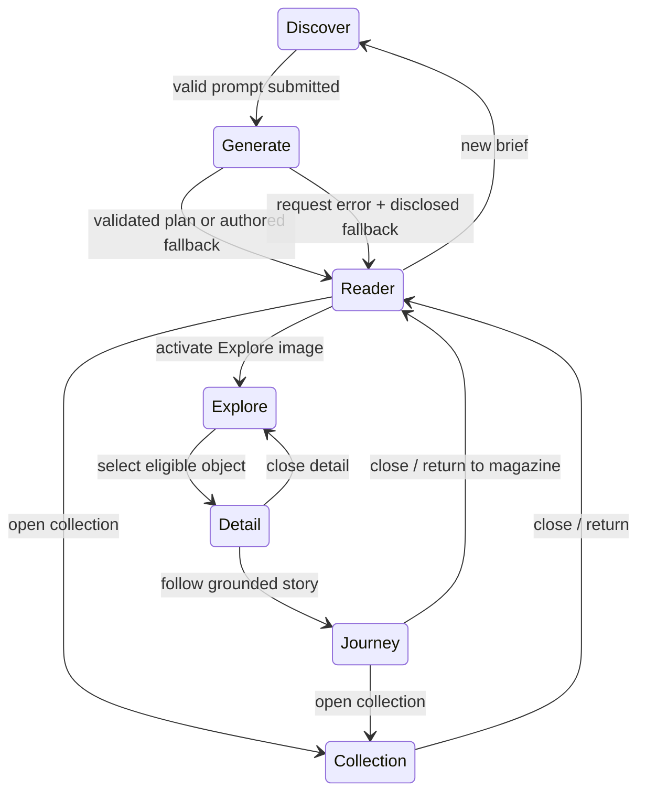

# Curio interaction blueprint (vertical slice)

The five approved references remain the art direction. This blueprint maps their spatial compositions to application state; decorative photographs and orbit lines never become invented catalog relationships.

| Stage | Purpose and primary action | State and motion | Return or recovery |
| --- | --- | --- | --- |
| Discover (#1) | Commission a magazine with an editable natural-language brief; examples fill the same field. Consent is optional. | `draft`, `consent`, validation error. Focus subtly responds within the orbit composition. | An invalid brief stays in place; a new discovery clears only the previous edition's active reading context. |
| Generate (#2) | Show a real pending request and its existing image composition. | `request=loading`; the photographic planes assemble without percentages or provisional model claims. | A failed/unavailable request resolves to the disclosed authored edition. No mandatory wait or retry loop. |
| Read & Explore (#3) | Read the validated feature sequence. A visible **Explore image** action activates eligible object annotations inside the photo. | `edition`, `featureIndex`, `exploring`, `selectedObject`. Entering a spread uses an editorial fade; activating Explore reveals only validated/manual annotations. Selection shifts focus to a translucent contextual layer while the source photograph stays visible. | Closing detail returns focus to its hotspot; changing spread clears object selection; opening a story retains the active spread. |
| Curiosity Journey (#4) | Follow a grounded relationship from the current story and inspect related records. | `journeyOrigin` (asset/version and feature index), `story`, `related`, `topic`, local navigation history. Motion traces a relationship only when data supplies it. | Close returns to the same Reader instance and spread; following another record extends the path rather than resetting the magazine. |
| My Collection (#5) | Revisit saved image/story records with their exact version IDs. | `saved` from existing local storage, selected item; saving gives inline feedback in the originating stage. | Opening Collection is explicit. Closing returns to the Reader or Discover; invalid/revoked records are filtered by the existing revalidation path. |

Behavior lives in the existing `EditorialExperience` edition/request/story/collection state and `VisualReader` spread/exploration state. The Reader remains mounted behind the native story dialog, preserving its position and current spread. A save mutates the versioned collection and announces success; it does not force a stage change. A new prompt is the only action that replaces the current edition.

Motion vocabulary: **editorial reveal** for a new spread, **spatial focus** when eligible hotspots appear, **context expansion** for object detail, **relationship transition** into Journey, and **return** by closing the dialog. Each transition is short, interruptible, and disabled under `prefers-reduced-motion`. The same buttons work with mouse, touch and keyboard. On a narrow screen, the detail surface stays readable and does not cover the primary image action.

The first vertical slice uses the approved Paper Moon Lamp catalog illustration and its existing authored object annotation. It exercises prompt → real pending state → validated/authored Reader → Explore → contextual detail → story/Journey → Collect → return. It does not claim SAM inference or independently verified product facts. The other approved screens and their image allocations are unchanged in this slice.
